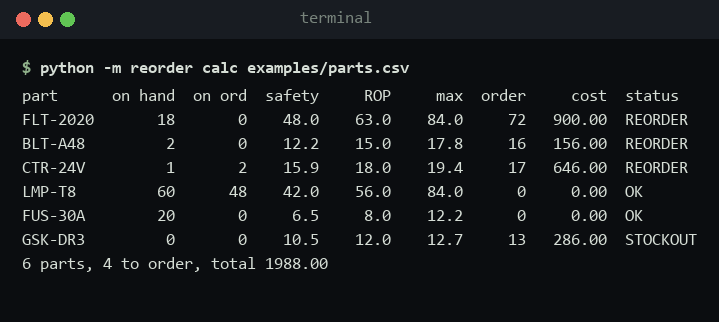

# parts-reorder-calculator

Running out of a belt or a filter stops a repair; stocking too many ties up money. This repo takes a CSV of maintenance parts with their usage and lead times and calculates safety stock, reorder point, max level and the exact quantity to order, rounded to the pack size.



## What it is for

Storeroom coordinators and maintenance planners who keep min/max levels in a spreadsheet use this to recalculate them from real usage and lead times. It answers three questions for every part: is it time to reorder, how many, and what will the order cost.

## Install

```
git clone https://github.com/yassine2med/parts-reorder-calculator
cd parts-reorder-calculator && pip install -r requirements.txt
```

## How to use

| I want to | Command |
|---|---|
| Calculate every part | `PYTHONPATH=src python -m reorder calc examples/parts.csv` |
| Show only parts that need an order | `PYTHONPATH=src python -m reorder calc examples/parts.csv --only-orders` |
| Change the review period to 30 days | `PYTHONPATH=src python -m reorder calc examples/parts.csv --review-days 30` |
| Save the result as CSV | `PYTHONPATH=src python -m reorder calc examples/parts.csv --out result.csv` |
| Show help | `PYTHONPATH=src python -m reorder --help` |

Exit codes: 0 when nothing needs ordering, 1 when at least one part needs an order, 2 for a missing file or bad data.

Example:

```
PYTHONPATH=src python -m reorder calc examples/parts.csv
```

Output:

```
part      on hand  on ord  safety     ROP     max  order     cost  status
FLT-2020       18       0    48.0    63.0    84.0     72   900.00  REORDER
BLT-A48         2       0    12.2    15.0    17.8     16   156.00  REORDER
CTR-24V         1       2    15.9    18.0    19.4     17   646.00  REORDER
LMP-T8         60      48    42.0    56.0    84.0      0     0.00  OK
FUS-30A        20       0     6.5     8.0    12.2      0     0.00  OK
GSK-DR3         0       0    10.5    12.0    12.7     13   286.00  STOCKOUT
6 parts, 4 to order, total 1988.00
```

Run the tests with `python -m pytest -q`.

## How it works

1. Safety stock = max daily use x max lead time - average daily use x normal lead time (never below zero).
2. Reorder point (ROP) = average daily use x lead time + safety stock.
3. Max level = ROP + average daily use x review days (default 14).
4. Inventory position = on hand + on order. At or below the ROP, the order brings the position up to max, rounded up to `order_multiple`.
5. Status: STOCKOUT when nothing is on hand, REORDER when an order is needed, ON ORDER when stock is low but an order is already coming, OK otherwise.

## Limits

- Inputs are single numbers per part. It does not read usage history or fit a demand curve.
- It does not model price breaks, minimum order values or supplier calendars.
- Safety stock uses the worst case, which is cautious; lower `max_daily_use` and `max_lead_time_days` to carry less.

## License

MIT. Yassine Emhamed, 2026.
